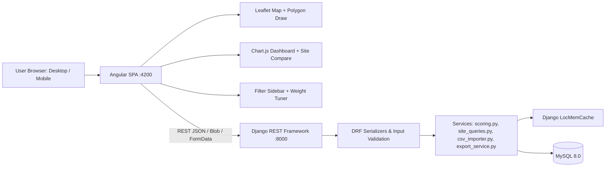

# Solar Panel Site Analyzer

A full-stack spatial analysis web application for screening, scoring, and comparing candidate utility-scale solar panel installation sites. Built for the **Datasee.AI Full Stack Developer Technical Assessment** using **Angular**, **Django REST Framework**, **MySQL 8.0**, **Leaflet**, and **Chart.js**.

---

## Key Features

### Core Capabilities
- **Spatial Dataset Ingestion:** Load the provided 50-site Tamil Nadu dataset via CLI (`seed_solar_sites`) or upload new `.csv` datasets directly from the UI (`POST /api/sites/upload/`).
- **Weighted Suitability Scoring Engine:** Evaluates each site (`0–100`) across Solar Irradiance, Available Land Area, Power Grid Proximity, Terrain Slope, and Road/Infrastructure Proximity.
- **Interactive GIS Map (Leaflet):** Color-coded, capacity-scaled site markers with **Street**, **Satellite**, and **Topographic** base-layer switching, suitability legend, and click-to-inspect details.
- **Filtering, Searching & Sorting:** Filter dynamically by minimum suitability score, region, land type, and keyword search; sort by score, area, irradiance, grid distance, slope, or name.
- **Site Engineering Detail Drawer:** Displays rank, category, estimated capacity (`MW`), area (`m²` & `acres`), pre-construction risk flags, and a Chart.js factor breakdown chart.
- **Analytics Dashboard:** Executive KPI cards, suitability distribution bar chart, land-type comparison chart, Top 10 recommended sites table, and **CSV / JSON export**.
- **Responsive Design:** Adapts cleanly across desktop split-screen and mobile/tablet layouts.

### Bonus Capabilities Implemented
- **Real-Time Weight Tuner:** Adjust all 5 factor weights with live `100%` validation in **Preview** (non-persisted) or **Apply & Save** (persisted snapshot) modes.
- **Custom Polygon Zone Analysis:** Draw custom polygons directly on the Leaflet map to compute site count, average score, total area, and total MW within the boundary.
- **Multi-Site Comparison:** Pin up to 3 sites for side-by-side metric comparison and an overlaid Chart.js radar chart.
- **Performance Caching:** Versioned in-memory caching for `/api/statistics/` with automatic invalidation on weight recalculation or CSV upload.
- **Automated Tests & Swagger Docs:** Django unit/API test suite, Angular Vitest unit tests, and OpenAPI/Swagger UI at `/api/docs/`.

---

## Tech Stack

- **Frontend:** Angular (TypeScript, Standalone Components, Signals), Leaflet, Chart.js, SCSS
- **Backend:** Python 3.13, Django, Django REST Framework, `django-cors-headers`, `drf-spectacular`
- **Database:** MySQL 8.0 (`sites`, `analysis_parameters`, `analysis_results`, `sites_with_scores` view, `calculate_suitability_scores()` procedure, `get_site_rank()` function)

---

## Architecture Overview



### Repository Structure

```text
D:\Assessment\
├── README.md
├── Backend\
│   ├── requirements.txt
│   └── datasee_backend\
│       ├── .env.example
│       ├── manage.py
│       ├── sql\
│       │   ├── database_schema.sql
│       │   └── solar_sites_data.csv
│       ├── datasee_backend\          # Django project settings & root URLs
│       └── sites_api\                # Models, serializers, services, views, tests, seeder
└── Frontend\
    ├── angular.json
    ├── package.json
    └── src\
        ├── environments\
        └── app\
            ├── models\               # TypeScript API contracts
            ├── services\             # SolarApiService (HttpClient)
            └── components\           # Navbar, FilterSidebar, WeightTuner, SolarMap,
                                      # SiteDetailDrawer, AnalyticsDashboard, SiteCompare, CsvUploadModal
```

---

## Spatial Suitability Formula

Total Suitability Score (`0–100`):

```text
Total Score = (solar_score * 0.35)
            + (area_score * 0.25)
            + (grid_distance_score * 0.20)
            + (slope_score * 0.15)
            + (infrastructure_score * 0.05)
```

| Factor | Optimal (`100`) | Minimum (`0`) | Intermediate Scaling |
| :--- | :--- | :--- | :--- |
| **Solar Irradiance** (`kWh/m²/day`) | `>= 5.5` | `< 3.0` | Linear `3.0 → 5.5` |
| **Available Area** (`m²`) | `>= 50,000` | `< 5,000` | Linear `5,000 → 50,000` |
| **Grid Distance** (`km`) | `<= 1.0` | `>= 20.0` | Inverse linear `1.0 → 20.0` |
| **Terrain Slope** (`degrees`) | `<= 5.0` | `> 20.0` | Piecewise: `5–15°` (`100 → 50`), `15–20°` (`50 → 0`) |
| **Road / Infrastructure** (`km`) | `<= 0.5` | `>= 5.0` | Inverse linear `0.5 → 5.0` |

**Classification Tiers:** `80–100` Excellent (`#16a34a`) · `60–79` Good (`#65a30d`) · `40–59` Fair (`#eab308`) · `20–39` Poor (`#f97316`) · `0–19` Very Poor (`#dc2626`).

---

## Setup & Running Locally

### Prerequisites
- Python `3.11+`
- MySQL Server `8.0+`
- Node.js `20+` & npm

### 1. Database Setup (MySQL 8.0)
Create the target schema using the provided SQL script (`Backend\datasee_backend\sql\database_schema.sql`):

```powershell
cd Backend\datasee_backend
mysql -u root -p < .\sql\database_schema.sql
```

> **Note:** `database_schema.sql` defaults to `CREATE DATABASE IF NOT EXISTS solar_site_analyzer; USE solar_site_analyzer;`. If you configure a different database name in `.env` / `settings.py` (such as `dataseesite`), create that database and execute `database_schema.sql` inside it.

### 2. Backend Setup (Django REST Framework)

```powershell
cd Backend
python -m venv venv
.\venv\Scripts\Activate.ps1
pip install -r requirements.txt

cd datasee_backend
copy .env.example .env
# Edit .env (or DATABASES in datasee_backend\settings.py) with your MySQL credentials

python manage.py migrate
python manage.py seed_solar_sites
python manage.py runserver 8000
```

- **Backend API Base:** `http://localhost:8000/api/`
- **Interactive Swagger Docs:** `http://localhost:8000/api/docs/`

### 3. Frontend Setup (Angular)

```powershell
cd Frontend
npm install
npm start
```

- **Frontend App URL:** `http://localhost:4200`

### 4. Running Tests

```powershell
# Backend unit & API tests
cd Backend\datasee_backend
python manage.py test sites_api --verbosity=2

# Frontend production build & Vitest unit tests
cd Frontend
npm run build
npx ng test --watch=false
```

---

## API Reference

| Method & Endpoint | Description | Query / Request Parameters |
| :--- | :--- | :--- |
| `GET /api/health/` | Database & service health check | — |
| `GET /api/sites/` | List scored sites with filtering, sorting & pagination | `min_score`, `max_score`, `region`, `land_type`, `search`, `sort_by`, `sort_order`, `limit`, `offset` |
| `GET /api/sites/{site_id}/` | Detailed site metrics, 5-factor breakdown, weighted contributions & global rank | Path: `site_id` (`404` if not found) |
| `POST /api/analyze/` | Recalculate scores with custom weights (`sum == 1.0 ± 0.001`) | `{ "weights": { "solar": 0.4, "area": 0.3, "grid": 0.15, "slope": 0.1, "infrastructure": 0.05 }, "persist": true }` |
| `POST /api/analyze/polygon/` | Filter & summarize sites inside a custom polygon | `{ "polygon": [[lat, lon], ...] }` (min 3 vertices) |
| `GET /api/weights/` | Retrieve currently active factor weights | — |
| `GET /api/statistics/` | Summary KPIs, 5-tier distribution, land-type & region averages, Top 10 sites | Optional `min_score`, `max_score`, `region`, `land_type` |
| `GET /api/export/` | Download filtered results as CSV or JSON | `format=csv\|json`, `min_score`, `max_score`, `region`, `land_type` |
| `POST /api/sites/upload/` | Upload and score a `.csv` site dataset (max 5 MB) | Multipart form field: `file` |

### Example `POST /api/analyze/` Request & Response

**Request:**
```json
{
  "weights": {
    "solar": 0.45,
    "area": 0.25,
    "grid": 0.15,
    "slope": 0.10,
    "infrastructure": 0.05
  },
  "persist": false
}
```

**Response (`200 OK`):**
```json
{
  "persisted": false,
  "weights_used": {
    "solar": 0.45,
    "area": 0.25,
    "grid": 0.15,
    "slope": 0.1,
    "infrastructure": 0.05
  },
  "total_sites": 50,
  "average_score": 90.41,
  "results": [
    {
      "site_id": 4,
      "site_name": "Udumalpet Solar Park",
      "total_suitability_score": 100.0,
      "category": "Excellent",
      "rank": 1,
      "estimated_capacity_mw": 7.8
    }
  ]
}
```

---

## Key Design Decisions & Security

- **Deterministic Latest-Score & Competition Ranking:** Latest results are resolved via `(-analysis_timestamp, -result_id)` to avoid 1-second `TIMESTAMP` ties, and `_assign_ranks()` uses competition ranking (`1, 1, 3...`) matching MySQL's `get_site_rank()`.
- **SQL & CSV Injection Protection:** All database access uses parameterized Django ORM queries and whitelisted `sort_by` fields; CSV exports escape cells starting with `=`, `+`, `-`, `@`, `\t`, or `\r`.
- **Stateless Preview vs. Persisted Analysis:** `POST /api/analyze/` supports `persist: false` for non-destructive what-if exploration and `persist: true` to record a new `analysis_results` snapshot and invalidate cached statistics.

---

## Known Limitations & Future Improvements

- **Point-Based Geometries:** Sites are currently modeled as `[latitude, longitude]` centroids rather than true parcel polygons (`GeoJSON` / `POLYGON`).
- **In-Memory Statistics & Filtering:** Suitable for hundreds to a few thousand sites; scaling to `100k+` parcels would benefit from MySQL Spatial / PostGIS (`ST_Contains`, `SPATIAL INDEX`), Redis caching, and database-side aggregation queries.
- **Single-Tenant Configuration:** Adding JWT/OAuth2 authentication and per-user saved scenarios would support multi-team enterprise workflows.
- **Deployment & CI/CD:** Add `Dockerfile`s, `docker-compose.yml`, and GitHub Actions pipelines to automate testing and deployment.
