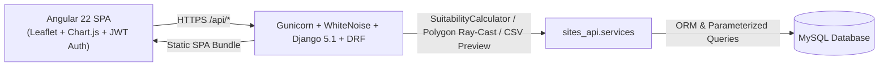

# Solar Panel Site Analyzer (`DATASEE.AI`)

A full-stack geospatial decision-support web application built with **Django 5.1**, **Django REST Framework**, **MySQL**, **Angular 22**, **Leaflet**, and **Chart.js** for pre-construction utility-scale solar site suitability screening across Tamil Nadu (Coimbatore, Tiruppur, Erode, Pollachi, Udumalpet, and surrounding regions).

---

## Live Application & Demo Access

| Resource | URL |
| :--- | :--- |
| **Live Web App** | https://dataseeai-production.up.railway.app/ |
| **Django Admin Panel** | https://dataseeai-production.up.railway.app/admin/ |
| **OpenAPI / Swagger Docs** | https://dataseeai-production.up.railway.app/api/docs/ |
| **Health Check** | https://dataseeai-production.up.railway.app/api/health/ |

### Demo Login Credentials

The application opens to a full-screen video-backed JWT sign-in experience. Use the following credentials to sign in (both in the web app and Django Admin):

- **Username:** `admin`
- **Password:** `12345`

---

## Implemented Features

### Authentication & Branding
- **JWT Login-Only Screen (`AuthScreenComponent`):** Full-screen background video (`hero.mp4` with `datasee-hero-poster.png` fallback), Datasee.AI branding, dark glass login card, password visibility toggle, and automatic JWT token attachment/refresh (`AuthInterceptor` + `AuthService`).
- **Django Admin & API Docs:** Integrated Django Admin (`/admin/`) and interactive OpenAPI 3 / Swagger UI (`/api/docs/` via `drf-spectacular`).
- **Custom Favicon & Social Share Preview:** Official Datasee.AI favicon (`favicon.ico`) and Open Graph / Twitter metadata (`og-share.jpg`) for link previews on WhatsApp and social platforms.

### Spatial Exploration & Suitability Scoring
- **Interactive Leaflet GIS Map:** Renders sites as capacity-scaled (`sqrt(capacity_mw)`), suitability-tier color-coded markers across **Esri World Street Map**, **Esri World Imagery (Satellite)**, and **Esri World Topographic Map** base layers.
- **Weighted Suitability Scoring Engine:** Computes transparent component scores (`irradiance`, `grid`, `slope`, `road`, `elevation`), total weighted score (`0–100`), suitability category, estimated generation (`MWh/yr`), CO₂ offset (`tonnes/yr`), and competition rank.
- **Interactive Weight Tuner:** Adjust the 5 criteria weights (`solar_irradiance`, `grid_proximity`, `slope`, `road_access`, `elevation`), enforce exact `100%` sum validation, run live **Preview Recalculation**, or **Save & Persist** globally for authenticated users.
- **Dynamic Filtering & Sorting:** Filter by search query (site name or region), minimum suitability score, land type, and region; sort ascending/descending by suitability score, solar irradiance, capacity, grid distance, or area.
- **Polygon Zone Analysis:** Click **Draw Analysis Zone** directly on the map to define an arbitrary polygon and compute zone statistics (`sites_in_zone`, `average_score`, `total_capacity_mw`, `total_area_sqm`) using server-side ray-casting.
- **Multi-Site Comparison & Detail Drawer:** Inspect site factor breakdowns, capacity metrics, solar telemetry charts, and quick links to **Edit Site** or **Delete Site**, or select multiple sites for side-by-side comparison.

### Site CRUD, CSV Preview Import & Data Export
- **Add / Edit / Delete Site Workflow (`SiteFormComponent`):** Dedicated navigation tab (`+ Add Site`) supporting full site creation, editing pre-filled sites from the detail drawer, live suitability score preview, and site deletion (with confirmation).
- **CSV Upload with Preview Before Confirm (`CsvUploadModalComponent`):** Upload a `.csv` dataset (up to `5 MB`) for dry-run backend validation (`preview=true`), inspect valid/invalid row previews before writing to MySQL, confirm import, or download the bundled template (`sample_solar_sites.csv`).
- **Right-Aligned Workspace Actions & Responsive Layout:** Desktop single-row navbar with right-aligned **Upload / Export** dropdown (`Upload CSV`, `Export CSV`, `Export JSON`) alongside user status/logout; mobile-first responsive layout with fixed bottom navigation and a **Tools** menu.
- **Safe Data Exports:** Export filtered datasets as formula-injection-safe **CSV** or **JSON**.

---

## Tech Stack

| Layer | Technology |
| :--- | :--- |
| **Backend API** | Python 3.13, Django 5.1.15, Django REST Framework 3.15.2 |
| **Authentication & Docs** | `djangorestframework-simplejwt` 5.5.1, `drf-spectacular` 0.28.0 |
| **Database** | MySQL (`mysqlclient` 2.2.8) |
| **Production Serving** | Gunicorn, WhiteNoise (`Dockerfile` multi-stage build) |
| **Frontend SPA** | Angular 22.3.0, TypeScript, SCSS |
| **Maps & Charts** | Leaflet 1.9.4 (Esri ArcGIS tiles), Chart.js 4.6.2 |
| **Frontend Tests** | Vitest (`npx ng test --watch=false`) |

---

## System Architecture



---

## Repository Structure

```text
.
├── Dockerfile                         # Single-service build: Angular dist + Django + Gunicorn
├── .dockerignore
├── .gitignore
├── README.md
├── Backend/
│   └── datasee_backend/
│       ├── manage.py
│       ├── requirements.txt
│       ├── start.sh                   # Runtime startup: schema ensure, migrate, seed, gunicorn
│       ├── datasee_backend/
│       │   ├── settings.py
│       │   ├── urls.py
│       │   └── wsgi.py
│       └── sites_api/
│           ├── admin.py
│           ├── urls.py
│           ├── management/commands/
│           │   ├── ensure_schema.py
│           │   └── seed_solar_sites.py
│           ├── models/
│           │   ├── SiteModel.py
│           │   ├── AnalysisParameterModel.py
│           │   └── AnalysisResultModel.py
│           ├── serializers/
│           │   ├── AuthSerializer.py
│           │   └── SiteSerializer.py
│           ├── services/
│           │   ├── scoring.py
│           │   ├── site_queries.py
│           │   ├── csv_importer.py
│           │   └── export_service.py
│           ├── views/
│           │   ├── AuthViews.py
│           │   ├── SiteViews.py
│           │   ├── AnalysisViews.py
│           │   └── ExportViews.py
│           └── tests/
│               └── test_scoring.py
└── Frontend/
    ├── README.md
    ├── package.json
    ├── angular.json
    ├── public/
    │   ├── favicon.ico
    │   ├── og-share.jpg
    │   ├── datasee-hero-poster.png
    │   ├── datasee-logo-black.svg
    │   ├── datasee-logo-white.svg
    │   ├── hero.mp4
    │   └── sample_solar_sites.csv
    └── src/
        ├── index.html
        ├── styles.scss
        ├── environments/
        │   ├── environment.ts
        │   └── environment.prod.ts
        └── app/
            ├── app.ts
            ├── app.config.ts
            ├── app.spec.ts
            ├── interceptors/auth.interceptor.ts
            ├── services/auth.service.ts
            └── components/
                ├── auth-screen/
                ├── navbar/
                ├── solar-map/
                ├── filter-sidebar/
                ├── weight-tuner/
                ├── site-detail-drawer/
                ├── analytics-dashboard/
                ├── site-compare/
                ├── site-form/
                └── csv-upload-modal/
```

---

## Suitability Scoring Model

Each candidate site receives component scores normalized to `0–100`:

1. **Solar Irradiance (`35%` default):** Scaled between `4.0` and `7.0 kWh/m²/day`.
2. **Grid Proximity (`25%` default):** Best at `0 km`, decaying toward `20 km`.
3. **Terrain Slope (`15%` default):** Flat terrain (`<= 2°`) scores `100`, decaying toward `15°`.
4. **Road Access (`15%` default):** Best at `0 km`, decaying toward `10 km`.
5. **Elevation (`10%` default):** Optimal around `300 m`, decaying with distance from optimal up to `1500 m`.

Derived solar energy estimates:
- `usable_area_ratio = 0.70`, `panel_power_density_kw_per_sqm = 0.18`, `performance_ratio = 0.80`
- `estimated_capacity_mw = (area_sqm * 0.70 * 0.18) / 1000`
- `estimated_annual_generation_mwh = estimated_capacity_mw * solar_irradiance_kwh * 365 * 0.80`
- `estimated_co2_offset_tonnes = estimated_annual_generation_mwh * 0.70`

---

## Local Development Setup

### Prerequisites
- Python `3.12+` / `3.13`
- Node.js `20+` and npm
- MySQL Server `8.0+`

### 1. Backend Setup (`Backend/datasee_backend`)

```bash
cd Backend/datasee_backend
python -m venv ../../venv
# Windows PowerShell: ..\..\venv\Scripts\Activate.ps1
# macOS/Linux: source ../../venv/bin/activate
pip install -r requirements.txt
```

Create a local `.env` file inside `Backend/datasee_backend/.env` with your local MySQL configuration:

```env
SECRET_KEY=your-local-django-secret
DEBUG=True
DB_NAME=dataseesite
DB_USER=root
DB_PASSWORD=your-mysql-password
DB_HOST=127.0.0.1
DB_PORT=3306
```

Initialize schema, apply migrations, create a login user, seed solar sites, and start the server:

```bash
python manage.py ensure_schema
python manage.py migrate
python manage.py createsuperuser --username admin --email admin@example.com
python manage.py seed_solar_sites --file data/solar_sites_raw.csv
python manage.py runserver 8000
```

> Use password `12345` when running `createsuperuser` if you want local login credentials to match the documented demo account.

### 2. Frontend Setup (`Frontend`)

```bash
cd Frontend
npm install
npm start
```

Open `http://localhost:4200/` in your browser (uses `src/environments/environment.ts` -> `http://localhost:8000/api`).

---

## Production Deployment (Docker / Railway)

The root [`Dockerfile`](Dockerfile) builds both tiers into a single deployable container:
1. Builds the Angular production bundle (`npm run build`, using `src/environments/environment.prod.ts` with `apiBaseUrl: '/api'`).
2. Installs Python dependencies from `Backend/datasee_backend/requirements.txt`.
3. Copies Angular `dist/solar-site-analyzer/browser` assets into Django static files (`collectstatic`) and serves both the SPA and `/api/` endpoints via Gunicorn + WhiteNoise.
4. Executes `Backend/datasee_backend/start.sh` on startup to ensure MySQL schema, run migrations, optionally seed demo data (`AUTO_SEED_SAMPLE_DATA`), and launch Gunicorn.

---

## API Reference

| Method | Endpoint | Auth | Description |
| :--- | :--- | :--- | :--- |
| `POST` | `/api/auth/login/` | Public | Obtain JWT `access` & `refresh` tokens + user profile |
| `POST` | `/api/auth/register/` | Public | Register a new user account & issue JWT tokens |
| `POST` | `/api/auth/refresh/` | Public | Refresh expired JWT `access` token |
| `GET` | `/api/auth/me/` | Bearer JWT | Get current authenticated user info |
| `GET` | `/api/health/` | Public | Service health status and total seeded site count |
| `GET` | `/api/sites/` | Public | List filtered, sorted, paginated sites (`limit`, `offset`, `search`, `min_score`, `land_type`, `region`, `sort_by`, `sort_order`) |
| `POST` | `/api/sites/` | Bearer JWT | Create a new solar site and compute its suitability score |
| `GET` | `/api/sites/{site_id}/` | Public | Retrieve detailed metrics for a single site |
| `PUT` / `PATCH` | `/api/sites/{site_id}/` | Bearer JWT | Update an existing site and recalculate suitability score |
| `DELETE` | `/api/sites/{site_id}/` | Bearer JWT | Delete a site |
| `POST` | `/api/sites/upload/` | Bearer JWT | Upload `.csv` dataset; supports `?preview=true` dry-run validation before commit |
| `GET` | `/api/statistics/` | Public | Aggregate KPIs, category distribution, region stats, and top sites |
| `GET` | `/api/weights/` | Public | Fetch active scoring parameter weights |
| `POST` | `/api/analyze/` | Public (preview) / JWT (`persist=true`) | Recalculate site scores with custom weights (`sum == 1.0`) |
| `POST` | `/api/analyze/polygon/` | Public | Compute site suitability statistics inside a drawn polygon |
| `GET` | `/api/export/` | Public | Export filtered sites (`format=csv` or `format=json`) |

---

## Verification & Testing

Run Django checks, OpenAPI schema validation, and backend unit tests:

```bash
cd Backend/datasee_backend
python manage.py check
python manage.py spectacular --validate
python manage.py test sites_api.tests.test_scoring
```

Run Frontend production build and Vitest unit tests:

```bash
cd Frontend
npm run build
npx ng test --watch=false
```

---

## Known Limitations & Future Scope

- **Multi-Tenant Role Isolation:** Authentication currently uses shared Django user accounts with JWT; per-user private saved weight scenarios and granular RBAC permissions can be added on top of `AnalysisParameterModel`.
- **Automated CI/CD & E2E Pipeline:** Container builds run automatically via Railway on push, while Playwright/Cypress E2E tests and GitHub Actions CI workflows remain future additions.
- **Tile Quota & Rate Limiting:** External Esri basemaps depend on public ArcGIS Online availability; production high-traffic rollouts should cache or proxy tiles and add DRF throttling on write endpoints.
